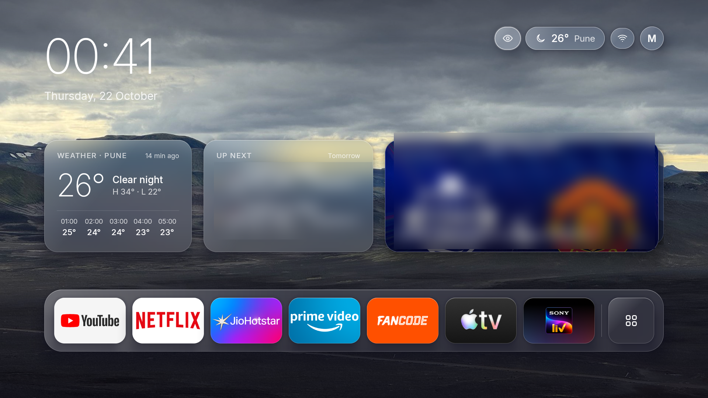
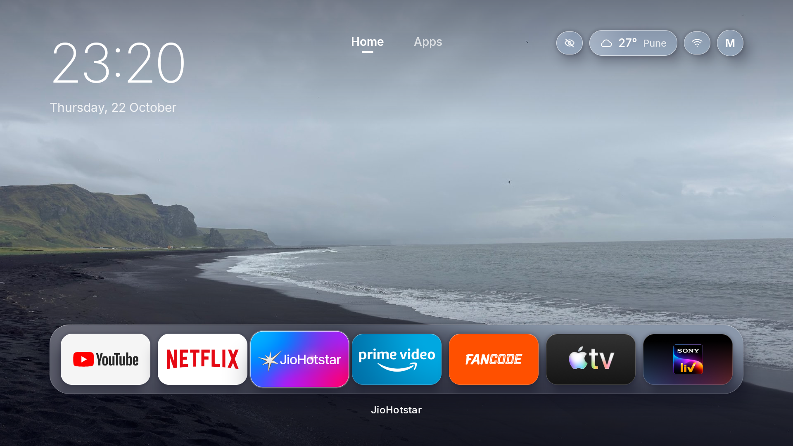
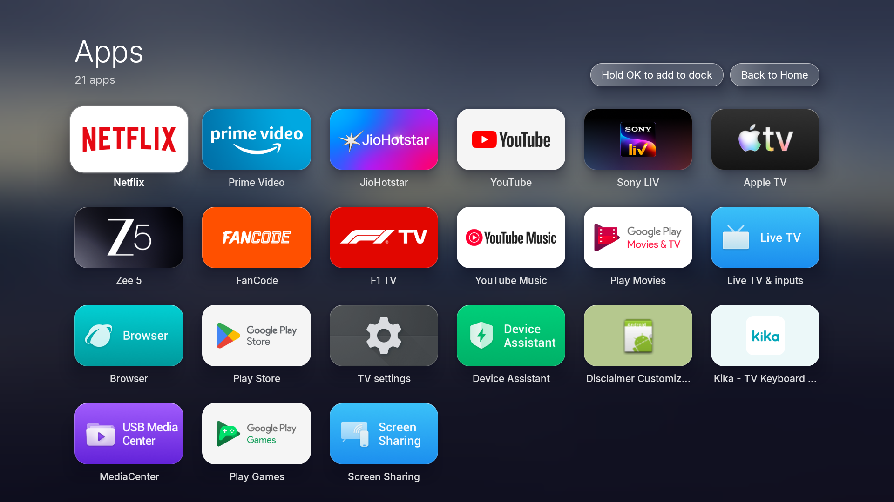
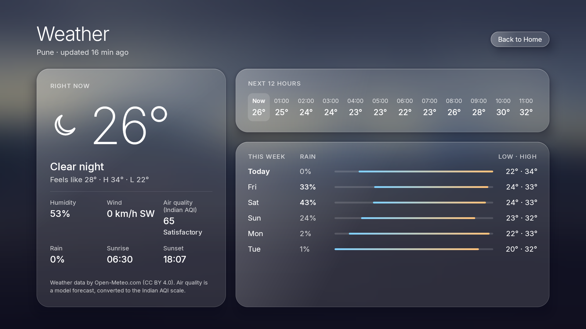
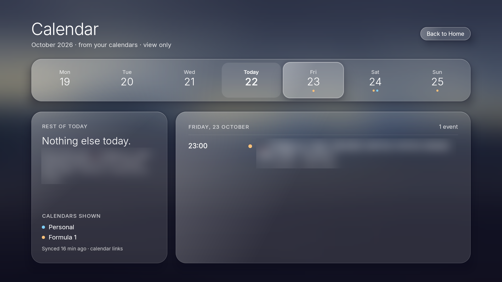
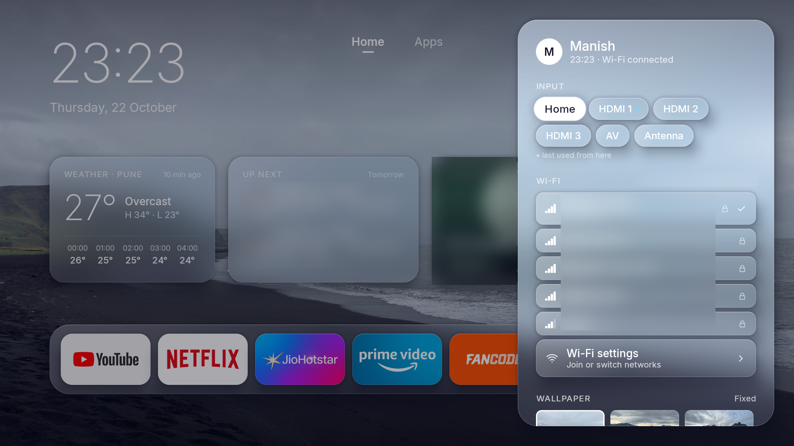
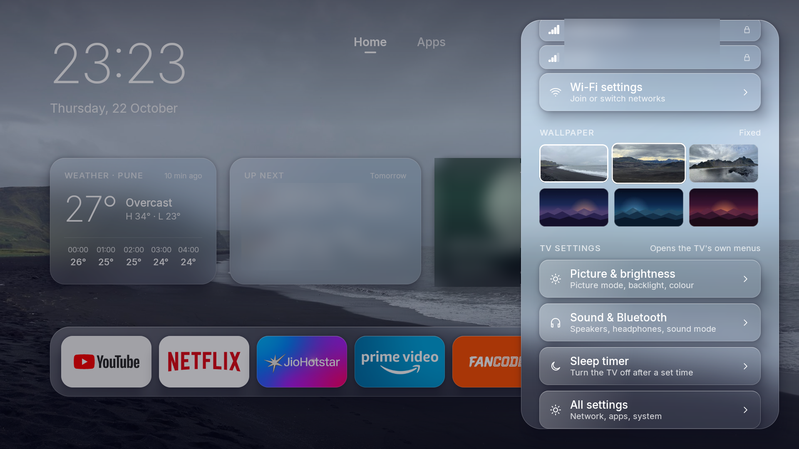
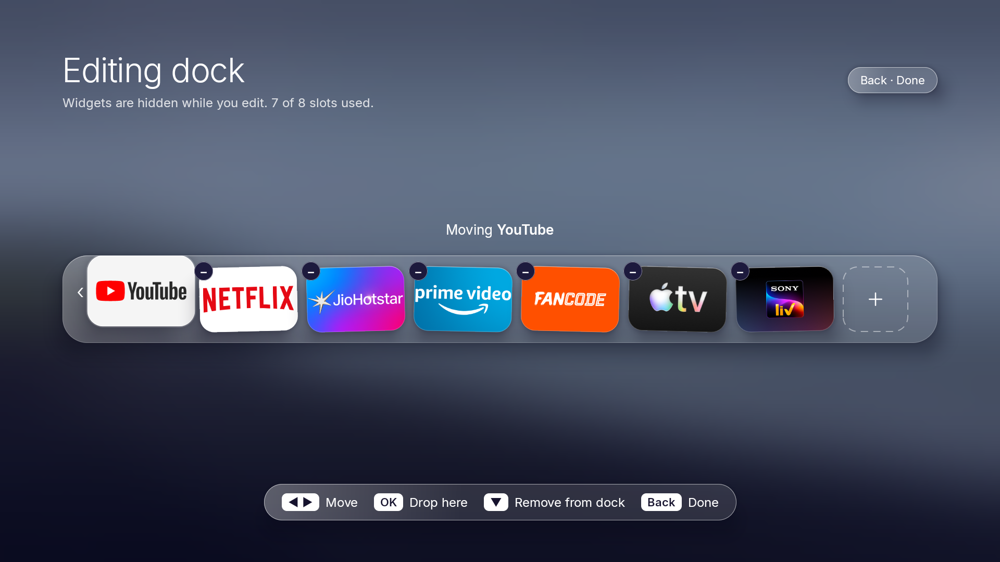
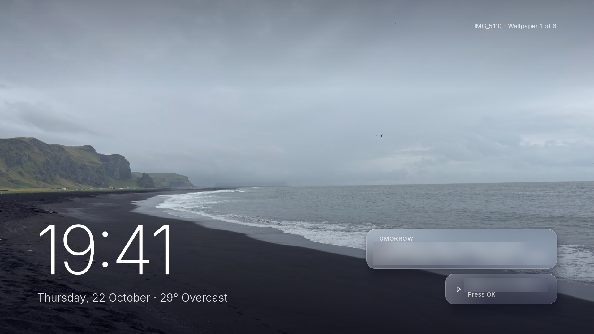

# Glass TV Launcher

A custom home screen for Android TV with a frosted-glass look: a clock, live widgets for weather, your calendars and what you're watching, and a dock of your apps. You can manage it from your phone over your home Wi-Fi. It replaces the stock Google TV home screen.

It was built for one TV, a VU (Hisense-made) Android TV 11 at 1920×1080, and it works there day to day. Most of it is plain Android TV and should work elsewhere, but a few parts are specific to Hisense/MediaTek TVs (see [Hardware notes](#hardware-notes)).



## What it does

**Home**
- Clock and date, a glass weather chip, and an eye button that hides or shows the widgets.
- Three widgets:
  - **Weather:** temperature, today's high and low, and the next hours.
  - **Up next:** your next calendar events.
  - **Now watching:** a card stack of shows and films you're partway through.
- A full-width dock of up to 8 apps, using each app's TV banner as its tile, plus an All apps grid.
- Glass effects without live blur: each card draws a pre-blurred copy of the wallpaper behind it.
- D-pad navigation designed for a TV remote. Holding Back for 5 seconds always opens Android Settings, as a recovery route.

**Widgets and full screens**
- **Weather** from [Open-Meteo](https://open-meteo.com), with the Indian air-quality index (CPCB method, from 24-hour PM2.5/PM10 averages), a 12-hour strip and a 6-day forecast. It refreshes every 30 min and keeps showing cached data offline, labelled with its age.
- **Calendars** from any ICS link: Apple iCloud public calendars or subscriptions such as a sports schedule. It handles repeating events, exceptions and time zones, and shows a week strip, the rest of today and each day's agenda.
- **Now watching:** ◀ ▶ flip through titles, OK resumes and holding OK shows details.
  - **Titles fill in automatically** from apps that share what's playing (JioHotstar, SonyLIV, YouTube and others).
  - **Hand-added titles** come from the phone, for apps that don't share (Netflix).

**Wallpapers, Ambient and the screensaver**
- Three built-in scenes plus your own photos, stored at 1080p. Home's wallpaper can be fixed or rotate daily, every few hours, or by time of day.
- After 3 minutes idle, Home turns into **Ambient**:
  - a slow, drifting slideshow with a big clock
  - your next event
  - a "Resume" shortcut
- The same Ambient screen also serves as the system screensaver.

**Quick settings** (OK on **M**, or the remote's Settings button)
- **Inputs:** switch between HDMI 1–3, AV and Antenna.
- **Wi-Fi:** nearby networks, with yours first.
- **Wallpapers:** pick Home's wallpaper.
- **TV settings:** shortcuts to the TV's own Picture, Sound and Sleep-timer menus.
- **Pair a phone.**

**Dock editing**
- Hold OK on a dock app to rearrange or remove apps. The tiles wiggle; ◀ ▶ move an app, ▼ removes it.
- In All apps, hold OK on an app to add it to the dock.

**Phone companion**
- **Pairing:** pair once by scanning a QR code on the TV.
- **Using it:** open a web page served by the TV, with four tabs:
  - **Watching:** add titles, set progress, upload artwork.
  - **Dock:** add, order and remove apps.
  - **Wallpapers:** upload photos and choose a mode.
  - **Calendar:** add ICS links.

**Remote buttons**
- The YouTube, Prime Video, Hotstar and Settings buttons on the remote keep working after the stock launcher is disabled. A small accessibility service handles them.

## Screenshots

Taken on the TV (1920×1080) with the owner's own photo as the wallpaper. Calendar events, watch titles and Wi-Fi network names are blurred for privacy.

| | |
|---|---|
| <br>Home with the widgets hidden (eye button) | <br>All apps |
| <br>Weather, with the Indian AQI | <br>Calendar |
| <br>Quick settings: inputs and Wi-Fi | <br>Quick settings: wallpapers and TV settings |
| <br>Dock editing (hold OK on an app) | <br>Ambient, after 3 minutes idle |

The [design/](design/) folder has the original mock-ups of every screen ([design/png](design/png)) with exact sizes and colours ([design/html](design/html)), including screens not shown above (phone pairing and the phone page).

## What's in this repo

```
app/src/main/java/com/manishlad/glasslauncher/
  MainActivity.kt        Home activity: key handling, idle → Ambient, launching apps/inputs
  LauncherViewModel.kt   Screen state, focus restore, Quick settings and dock-edit state
  GlassApp.kt            App-wide repositories, refresh loop, phone-companion server start
  AppRepository.kt       Launchable apps, banners, default dock
  Wallpaper.kt           Procedural scenes, scrim, pre-blur (the glass source)
  Ambient.kt             Slideshow controller (shared by Ambient and the screensaver)
  GlassDream.kt          System screensaver (DreamService)
  RemoteKeyService.kt    Accessibility service for the remote's app buttons
  MediaWatcher.kt        Notification listener: automatic Now watching from media sessions
  DevConfigReceiver.kt   adb-only config commands (calendars, watch list, wallpapers)
  DevImportProvider.kt   adb-only photo import (`content write`)
  companion/             Phone companion: HTTP server (NanoHTTPD), pairing and sessions
  data/                  Weather + Indian AQI, ICS calendars, Now watching, dock, wallpapers,
                         TV inputs, Wi-Fi, per-app media record
  ui/                    Compose screens: Home, widgets, All apps, expanded screens,
                         Ambient, Quick settings, dock editor, pairing, glass components
app/src/main/assets/companion/index.html   The phone web page (single file, no CDN)
app/src/test/                              Unit tests: AQI maths, ICS recurrence expansion
design/                                    Screen designs (PNG + HTML source)
docs/screenshots/                          Screenshots from the TV (private details blurred)
CLAUDE.md                                  Setup instructions for an AI coding agent
tv-check.sh                                Read-only TV check script → tv-report.txt
```

Built with Kotlin and Jetpack Compose (foundation only), with OkHttp, [biweekly](https://github.com/mangstadt/biweekly) for ICS, [NanoHTTPD](https://github.com/NanoHttpd/nanohttpd) and [ZXing](https://github.com/zxing/zxing). It targets Android 11 (API 30) and later.

## Getting it running

Setting the launcher up as a TV's home screen changes system settings, so it's done step by step with an undo for each change. **[CLAUDE.md](CLAUDE.md) has the full procedure**, written for an AI coding agent such as Claude Code but just as readable by a person.

For an already-set-up TV, building and installing comes down to:

```bash
./gradlew testReleaseUnitTest assembleRelease
```

```bash
adb -s <TV_IP>:5555 install -r app/build/outputs/apk/release/app-release.apk
```

Use the release build: Compose debug builds are noticeably slow on TV hardware.

## Using it

| Where | Key | Does |
|---|---|---|
| Anywhere on Home | ▲ ▼ ◀ ▶ | Move between the top bar, widgets and dock; ◀ ▶ stop at the ends |
| Dock | OK / hold OK | Open the app / edit the dock |
| Weather, Up next | OK | Full screen |
| Now watching | ◀ ▶ / OK / hold OK | Flip / resume / details |
| M (top right) | OK / hold OK | Quick settings / pair a phone |
| Eye (top right) | OK | Hide or show the widgets |
| All apps | Hold OK | Add the app to the dock |
| Anywhere | Back / hold Back 5 s | Back to the dock / Android Settings |
| Ambient | OK / any key | Resume the show / wake |

**Phone companion:** on the TV, go to Quick settings › Pair a phone, then scan the QR with your phone. The page works on any phone browser on the same Wi-Fi, at `http://<TV_IP>:8080`.

## Privacy and security

- Everything stays on the TV: no cloud backend, accounts or analytics. The only outside requests are to Open-Meteo for weather and to your calendar links.
- **Calendar links:** stored only in the app's private storage. They're never logged, never sent back to the phone, and never in this repo.
- **The phone server:**
  - It only answers devices on the home network that address the TV by IP, which blocks DNS-rebinding tricks.
  - Changes need a session cookie (`HttpOnly`, `SameSite=Strict`) plus a custom header. Pairing codes expire after 5 minutes and are replaced after 5 wrong tries, and the TV stores only hashes of session tokens.
  - The connection is plain `http` on the home network.
- **Automatic Now watching** reads only what apps publish as "now playing" (title, position, length, artwork). Notification contents are ignored.

## Known limitations

- **Netflix** doesn't share what's playing, so Netflix titles must be added from the phone. **JioHotstar** shares titles but no artwork.
- **Finished titles disappear:** automatically added titles are removed once 95% watched.
- **Current input unknown:** Android doesn't tell apps which input is on screen. Quick settings marks the last input picked there.
- **Wi-Fi switching:** apps can't switch Wi-Fi networks (Android 10+), so choosing a network opens the TV's Wi-Fi settings.
- **Fixed personal values:** the weather location (Pune), the profile name and the TV name are set in code; [CLAUDE.md](CLAUDE.md) lists where.
- **Memory:** about 100 MB PSS on Home and ~150 MB during the Ambient slideshow.

## Hardware notes

These parts are specific to the TV it was built on and may need adjusting elsewhere:

- **Remote app-button key codes** (YouTube 293, Prime Video 295, Hotstar 337, Settings 83) are from a VU/Hisense remote.
- **Live TV app:** `com.mediatek.wwtv.tvcenter` (MediaTek's Live TV app) plays the antenna input.
- **TV settings shortcuts** point to the system screens that open `android.settings.DISPLAY_SETTINGS`, `SOUND_SETTINGS` and `TIMER_SETTINGS`.
- **App theme:** must not inherit `Theme.DeviceDefault`. On this TV it made the home screen count as see-through, so the Home key left the previous app showing.

## Credits

- [Inter](https://rsms.me/inter/) typeface by Rasmus Andersson, bundled under the SIL Open Font License (see `third_party_inter_LICENSE.txt`).
- Weather data by [Open-Meteo.com](https://open-meteo.com) (CC BY 4.0). Air quality is a model forecast converted to the Indian AQI scale.
- biweekly, NanoHTTPD, ZXing, OkHttp and AndroidX under their respective licences.
